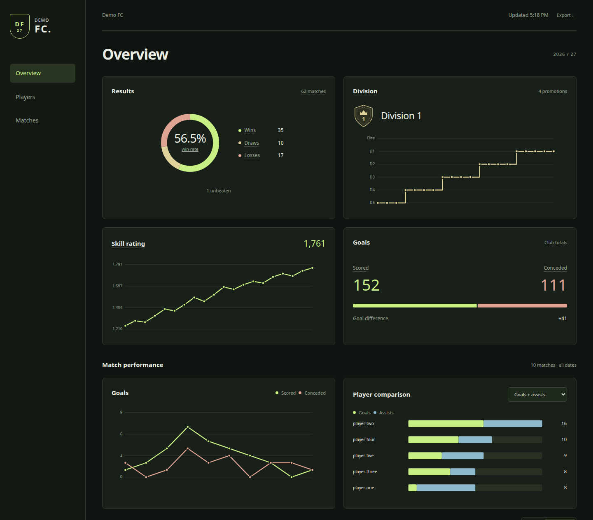
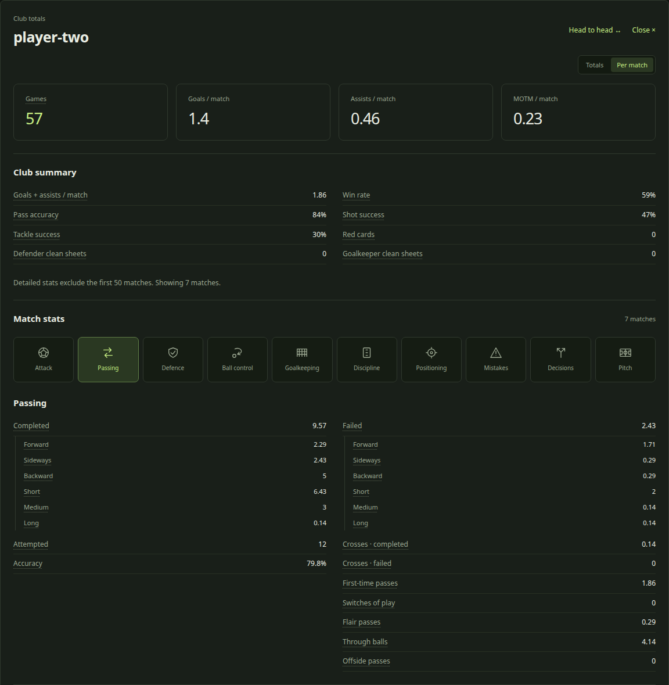
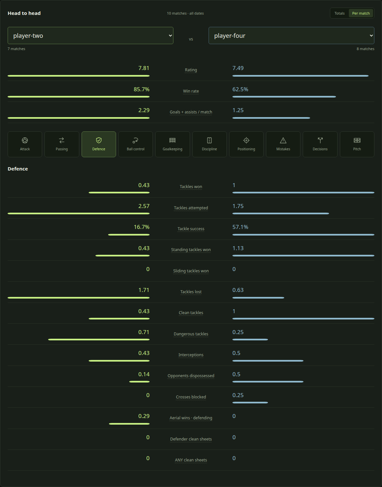

# EA FC Pro Clubs Tracker

**Your club’s season, beyond the last ten games.**

A self-hosted dashboard for team and player stats, match history and performance trends. Collected data stays in a persistent SQLite archive, with a clean, read-only dashboard to share with friends.



## Contents

- [Features](#features)
- [Quick start](#quick-start)
- [Sharing](#sharing)
- [Local checks](#local-checks)
- [More details](#more-details)

## Features

Follow how your club plays, what each player contributes, and how those patterns change throughout the season.

- **Keep your history** — captured matches stay in your archive after they disappear from EA’s recent-game window. Player IDs preserve history through name changes, and departed players remain available.
- **Understand your play style** — explore pass direction and distance, crosses, through balls, second assists, dribbling, interceptions, aerial duels, goalkeeper actions and mistakes. Ten stat categories cover both team and individual performances.
- **Measure progress** — chart team and player metrics by match, day, week or month, with rolling averages and comparisons between recent windows. Date and match-type filters let you focus on a session or part of the season.
- **Compare players** — head-to-head views show contributions, accuracy and detailed counters side by side. Switch between totals and per-match counts; accuracy uses combined attempts rather than averaging percentages.
- **Track mistakes** — follow possession losses, failed/offside passes, tackle losses, fouls and penalties for the team and each player, including how those counters change over time.
- **Review the details** — drill into league, friendly and playoff matches for both teams and individual players. Hover, focus or tap stat labels for explanations and calculations.

| Player profiles                                                                                                            | Head to head                                                                                               |
| -------------------------------------------------------------------------------------------------------------------------- | ---------------------------------------------------------------------------------------------------------- |
|  |  |

Trends use captured detailed matches; older missing games cannot be recovered from cumulative totals.

## Quick start

Requires **Python 3.11+**. No third-party runtime dependencies.

```bash
cp config.example.toml config.toml
# Set your club name, ID, platform and edition in config.toml.
python3 -m proclubs init
python3 -m proclubs collect
python3 -m proclubs serve
```

Open **http://127.0.0.1:8765**. On Linux, `bash scripts/setup.sh` installs the collector timer. It checks hourly while idle and every ten minutes during detected active play, respecting request spacing and error cooldowns. The machine must remain running to collect data.

## Sharing

With Tailscale installed and Funnel authorized:

```bash
bash scripts/share.sh start
```

This creates a password-protected viewer on loopback port **8766** and requests an HTTPS Funnel. Username: `club`; the generated password is in private `data/sharing-password.txt`. Visitors can browse stats but cannot edit data or trigger EA requests.

## Local checks

```bash
uv sync --frozen --group dev
npm ci --ignore-scripts
uv run python scripts/check.py
uv run python -m unittest discover -s tests
```

For desktop/mobile browser checks, run `uv run playwright install chromium`, then `uv run python tests/browser_smoke.py`. Checks use temporary archives and anonymized fixtures, with no EA requests. All checks and collection run locally.

## More details

[Setup, offline demo and backups](docs/operations.md) · [Stat inventory](docs/match-stats.md) · [Decoder research](docs/research.md) · [Security](docs/security.md)

Configuration, credentials and live match history are excluded from Git. EA’s API is undocumented, and outages can lose games beyond its recent-match window. This project is independent and unaffiliated with EA.
